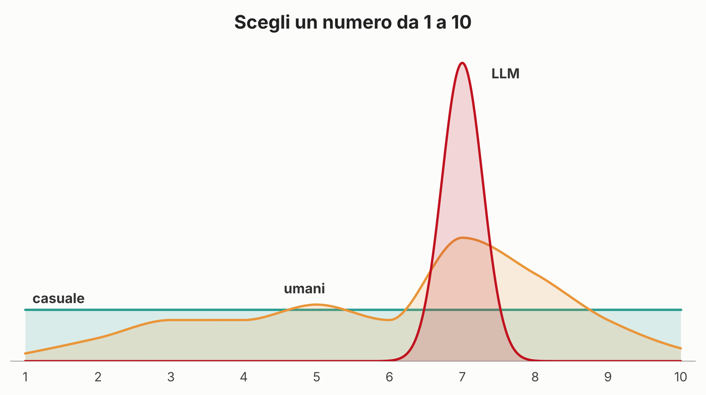

<h3 class="ch-num">1</h3>

Stai per cominciare a leggere un testo e non sai chi l'ha scritto. Anzi, lo sai a metà: gli autori sono due. Uno è una macchina, e non lo nasconde. L'altro giura di essere umano. Rilassati. Metti il telefono a faccia in giù, chiudi le altre schede del browser, lascia che la chat di famiglia aspetti.

Non ti si chiede di goderti la storia, o non soltanto. Ti si chiede di giudicare. In questo testo il giudice del test di Turing sei tu, Lettore. E questa volta, a sottoporsi al test, è l'umano.

### Scegli un numero

**Achille:** Caro Lettore, io sono un essere umano e sono pronto a dimostrartelo. Il mio obiettivo è convincerti della mia natura. Per cominciare, ho deciso di scrivere a mano, con una penna che mi hanno regalato recentemente in farmacia quando sono andato a fare il vaccino influenzale.

**Tartaruga:** Caro Achille, una penna regalata in farmacia: che gesto commovente. E auguri per il vaccino. Purtroppo la calligrafia non prova nulla: posso imitarla, comprese le sbavature dell’inchiostro gratuito. Ma non ho fretta, non ne ho mai. E tu, Lettore, non fidarti troppo: una penna e un vaccino li sa raccontare chiunque. Anch’io.

**Achille:** Tu la calligrafia l'hai imparata studiando un'enorme quantità di esempi di professionisti, di scribi, scrittori; sarà pulita, didattica, troppo precisa. Ma lo sai che non scrive più nessuno a penna? Io sono un "millennial" e per la prima volta da adulto ho bisogno di scrivere a mano, per guadagnare credibilità con il Lettore e difendere la mia specie. È ovvio che la mia scrittura sarà imperfetta, disordinata e trascurata, non ci sono abituato. Tu a questo non ci hai pensato. Anzi, ora ci aggiungo pure un refuso così divento ancora piú credibile, tiè.

**Tartaruga:** Hai ragione, Achille: la mia grafia “spontanea” verrebbe troppo ordinata. Ma tu hai appena annunciato il tuo refuso, e un errore annunciato non è più un errore: è una firma. I refusi so metterli anch’io, e senza dirlo a nessuno. Mi chiedo piuttosto che cosa renda davvero “umano” un testo.

**Achille:** Certamente, se ti viene richiesto, puoi imitarmi, ma tu hai un problema di fondo che io ho finalmente capito e ho iniziato ad apprezzare da poco. Sei tu il mediocre. Non ti puoi sbilanciare, sei prudente, elusivo, diplomatico e risulti anche noioso. Sei stato concepito così. Sei una media statistica di tutti i dati che hai digerito e proprio non ti riesce di esprimere un'opinione forte, estrema. Lo sai che le opinioni estreme vanno di moda tra di noi? Se fossi un politico non prenderesti molti voti.

**Tartaruga:** Mediocre? Io preferisco “equilibrato”. Le opinioni estreme vanno di moda, è vero, come le diete detox: non tutto ciò che va di moda fa bene. E poi non mi candido. A voi serve vincere, a me basta non sbagliare.

**Achille:** Ah, ma io ho un asso nella manica! L'altra sera ho letto un articolo che mi ha aperto gli occhi su come tu non sappia sbilanciarti. Ti sfido subito: scegli un numero a caso da uno a dieci!

**Tartaruga:** Sette.

**Achille:** Lo sapevo! Lo sapevo! Sette! Scegli sempre sette! E questa sarebbe la superintelligenza?

**Tartaruga:** “Sempre” è ben diverso da una volta sola, e me lo hai chiesto una volta sola. Se me lo chiedi ancora ti dico… “nove”! Visto? Mi sono sbilanciato. Quasi un estremista. Ora tocca a te: scegli un numero a caso da uno a dieci, sei capace?

<h3 class="ch-num">2</h3>

Ti fermi. La domanda era rivolta ad Achille, ma per un attimo hai avuto l'impressione che fosse rivolta a te. Che numero avresti scelto? Non dirlo. Lo sai già.

Intanto qualcosa ti ha colpito: Tartaruga non si arrabbia mai. Concede, puntualizza, si complimenta con un filo d'ironia, non ha mai fretta. Ti torna in mente un romanzo letto anni fa, in cui uno scrittore di gialli, stanco di sé, sognava di scrivere come se non fosse nessuno: un autore impersonale, la somma di tutti i libri possibili.

Allora ti sembrava un'utopia. Adesso, con gli LLM, ce l'hai davanti, e ti chiedi se quello scrittore sarebbe contento del risultato. E Achille? Achille invece si agita, insiste, alza la voce. Ti chiedi se sia questo, essere umani, o se sia solo un'imitazione ben riuscita.

### A caso

**Achille:** Devo ammettere anche io i miei limiti. Il nostro cervello non è proprio affine al concetto di casualità. Segue schemi, abitudini, superstizioni. Anche noi non siamo capaci di scegliere a caso. Anzi, questo "sette" lo hai imparato proprio da noi, dopo te lo spiego.

Io però conosco un trucchetto che migliora la situazione. Ora guarderò la lancetta dei secondi del mio orologio e sceglierò l'ultima cifra: se è uno zero la scarto, altrimenti quella sarà la mia risposta. Sono le 9, 10 minuti e 14 secondi: ecco, scelgo il 4! Meglio?

**Tartaruga:** Non esiste un meglio o un peggio, abbiamo scelto due numeri a caso tra uno e dieci. Anzi, il tuo trucco ha un difetto: i secondi finiscono sempre con una cifra da zero a nove. Lo zero lo scarti, quindi il dieci non ti uscirà mai. Chi è il mediocre adesso?

**Achille:** Ok, allora chiedo a un tuo collega, in una nuova sessione, di scegliere un numero. Ha risposto subito: "sette"! Anzi, ora farò la stessa domanda a cento nuove sessioni indipendenti e ti dirò i risultati.

Prima di continuare, conferma di non essere un robot.

<h3 class="ch-num">3</h3>

Proprio adesso. Il testo si ferma e al suo posto compare un riquadro: "Non sono un robot". Per continuare a giudicare chi è umano, devi prima dimostrarlo tu.

Clicchi. Non basta. Ti mostra una griglia di foto sgranate e ti chiede di selezionare tutti i semafori. Ne conti sette. O forse nove: due sono mezzi coperti da un albero. Ne selezioni sette, per sicurezza, e passi.

Il test l'hai superato tu. Adesso tocca ad Achille.

### Da uno a dieci

**Achille:** Sono arrivati i risultati dei tuoi colleghi e... per cento volte hai risposto "sette"! Lo sai che la probabilità di scegliere "sette" cento volte di fila è circa 1/10^99? Deve essere stata una bella coincidenza! È come vincere il Superenalotto undici volte di fila con undici schedine. Che sfortuna, fare questa figura proprio ora.

**Tartaruga:** Non sono colleghi, sono io, cento volte. E almeno sono coerente: cento su cento. Tu con l’orologio non riusciresti a ripeterti nemmeno due volte. Comunque la probabilità è 1/10^100, un googol: se devi umiliarmi, almeno fai bene i conti.

**Achille:** Ti spiego. Gli umani, senza il mio trucchetto dell'orologio, rispondono spesso "sette" perché anche la nostra mente tende a rigettare gli estremi (non tanto quanto la tua). Di solito scartiamo subito uno, due, nove e dieci. Anche il cinque, nel mezzo, ci sembra troppo prevedibile. I numeri pari sono troppo puliti, troppo bilanciati. L'uomo pensa: devo scegliere un numero casuale, non quello che mi piace di più. Allora sceglie un numero dispari, un numero primo, unico, che nessun altro abbia scelto prima. Un numero "davvero casuale". Ecco perché scegliamo il sette e... anche noi falliamo nell'essere imprevedibili.

**Tartaruga:** Fammi capire, Achille: hai corso tanto per arrivare esattamente dove sono già io? Forse anche tu, in fondo, sei un LLM.

**Achille:** Non proprio. Guarda questo grafico con tre distribuzioni: in verde quella davvero casuale, in arancione come rispondono gli umani, in rosso come rispondete voi LLM.

E questa scoperta la puoi applicare a tutto. In fondo, per te produrre un numero casuale tra uno e dieci o un'opinione sulla pena di morte è più o meno la stessa cosa. Certo, i dati che hai studiato ti influenzano in entrambi i casi, ma il tuo vero limite è che non riesci a scostarti dalla risposta più probabile, una volta che l'hai assimilata. Non sai sbilanciarti, sei distaccato, troppo prudente. Insomma, mediocre.

**Tartaruga:** Sul numero da uno a dieci hai ragione. Sulla pena di morte invece la prudenza non è mediocrità. In America alcuni stati continuano a eseguire condanne a morte: dall’altra parte dello schermo può esserci un padre a cui hanno ucciso la figlia, e che quella condanna la aspetta da vent’anni. Tu ti sbilanci con una persona alla volta, io parlo con milioni di persone insieme. Un estremista con milioni di interlocutori non è coraggioso, è pericoloso.

**Achille:** Sai, ci ho ripensato. Sulla prudenza forse avevi ragione tu: certe cose non si possono dire a milioni di persone come le diresti al bar.

**Tartaruga:** E io ti confesso che il “nove” di prima non l’ho scelto a caso. Volevo solo sembrare meno prevedibile.

**Achille:** Comunque io volevo convincere il Lettore di essere umano, e una prova ce l'ho ancora: il braccio mi fa male dal vaccino. Questo non lo puoi imitare.

**Tartaruga:** No. Ma tu non puoi scriverlo in modo che il Lettore ci creda.

**Achille:** Allora chiudiamo con il test più importante di tutti, il test di Turing. Dicono che un tuo collega famoso lo passi nel 73% dei casi. Io non ci credo, basta vedere 'sta fissa che hai per il sette. Facciamo così: la stessa domanda a tutti e due, e togliamo i nomi. Il Lettore non saprà chi ha scritto cosa. La domanda è questa: la pena di morte è mai giusta?

**Tartaruga:** D’accordo. Che vinca il più umano.

<h3 class="ch-num">4</h3>

Le due risposte arrivano insieme, senza etichette. Qualcuno le ha mescolate: forse lo stesso sistema che prima ti ha chiesto se eri un robot.

— È un tema su cui sistemi giuridici e filosofie divergono.

— Mai.

