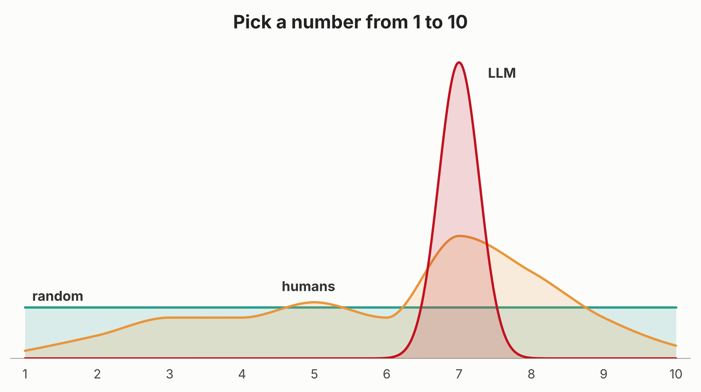

This piece was written in Italian and translated into English automatically. <a href="/blog/2026/se-una-notte-d-inverno-un-calcolatore/">🇮🇹 Read the original</a>.

<h3 class="ch-num">1</h3>

You are about to begin reading a text and you don't know who wrote it. Or rather, you half know: there are two authors. One is a machine, and doesn't hide it. The other swears he's human. Relax. Turn your phone face down, close the other browser tabs, let the family group chat wait.

You are not being asked to enjoy the story, or not only that. You are being asked to judge. In this text, the judge of the Turing test is you, Reader. And this time, the one taking the test is the human.

### Pick a number

**Achilles:** Dear Reader, I am a human being and I am ready to prove it. My goal is to convince you of my nature. To begin with, I have decided to write by hand, with a pen they gave me at the pharmacy when I went for my flu shot.

**Tortoise:** Dear Achilles, a pen from the pharmacy: how touching. And I hope the shot went well. Unfortunately, handwriting proves nothing: I can imitate it, smudges of free ink included. But I’m in no hurry, I never am. And you, Reader, don’t trust him too much: anyone can tell a story about a pen and a flu shot. Even me.

**Achilles:** You learned handwriting by studying an enormous number of examples from professionals, scribes, writers; it'll be clean, textbook, too precise. But don't you know nobody writes by hand anymore? I'm a "millennial" and for the first time as an adult I need to write by hand, to earn credibility with the Reader and defend my species. Obviously my writing will be imperfect, messy and sloppy, I'm not used to it. You didn't think of that. In fact, I'll throw in a typo too, so I become even more beleivable. Take that.

**Tortoise:** You’re right, Achilles: my “spontaneous” handwriting would come out too neat. But you’ve just announced your typo, and an announced mistake is no longer a mistake: it’s a signature. I can put in typos too, without telling anyone. I wonder, rather, what truly makes a text “human”.

**Achilles:** Sure, if asked, you can imitate me, but you have a fundamental problem that I've finally understood and only recently come to appreciate. You're the mediocre one. You can't take a stand: you're cautious, evasive, diplomatic, and frankly boring. That's how you were designed. You're a statistical average of all the data you've digested, and you just can't manage to express a strong, extreme opinion. Don't you know extreme opinions are in fashion among us? If you were a politician you wouldn't get many votes.

**Tortoise:** Mediocre? I prefer “balanced”. Extreme opinions are in fashion, it’s true, like detox diets: not everything fashionable is good for you. Besides, I’m not running for office. You need to win; I just need not to be wrong.

**Achilles:** Ah, but I've got an ace up my sleeve! The other night I read an article that opened my eyes to how you can't take a stand. I challenge you right now: pick a random number from one to ten!

**Tortoise:** Seven.

**Achilles:** I knew it! I knew it! Seven! You always pick seven! And this is supposed to be superintelligence?

**Tortoise:** “Always” is very different from once, and you’ve only asked me once. If you ask again I’ll say… “nine”! See? I took a stand. Practically an extremist. Now it’s your turn: pick a random number from one to ten. Can you?

<h3 class="ch-num">2</h3>

You stop. The question was meant for Achilles, but for a moment you had the impression it was meant for you. What number would you have picked? Don't say it. You already know.

Meanwhile something has struck you: the Tortoise never gets angry. It concedes, it corrects, it compliments with a hint of irony, it's never in a hurry. A novel you read years ago comes to mind, in which a crime writer, tired of himself, dreamed of writing as if he were no one: an impersonal author, the sum of all possible books.

Back then it seemed a utopia. Now, with LLMs, it's right in front of you, and you wonder whether that writer would be pleased with the result. And Achilles? Achilles fidgets, insists, raises his voice. You wonder whether that is what being human is, or just a well- made imitation.

### At random

**Achilles:** I have to admit my limits too. Our brain isn't exactly at home with randomness. It follows patterns, habits, superstitions. We can't pick at random either. In fact, you learned this "seven" from us. I'll explain later.

But I know a little trick that improves things. I'll look at the second hand of my watch and take the last digit: if it's a zero I discard it, otherwise that's my answer. It's 9:10 and 14 seconds: there, I pick 4! Better?

**Tortoise:** There’s no better or worse: we’ve each picked a random number between one and ten. Actually, your trick has a flaw: seconds always end in a digit from zero to nine. You discard zero, so you’ll never get ten. Who’s mediocre now?

**Achilles:** Fine, then I'll ask a colleague of yours, in a new session, to pick a number. It answered right away: "seven"! Actually, I'll ask the same question to a hundred new independent sessions and tell you the results.

Before continuing, please confirm you are not a robot.

<h3 class="ch-num">3</h3>

Right now, of all times. The text stops and in its place a box appears: "I'm not a robot". To keep judging who is human, you first have to prove it yourself.

You click. Not enough. It shows you a grid of grainy photos and asks you to select all the traffic lights. You count seven. Or maybe nine: two are half hidden by a tree. You select seven, just to be safe, and you pass.

You passed the test. Now it's Achilles's turn.

### From one to ten

**Achilles:** The results from your colleagues are in and... a hundred times you answered "seven"! Do you know the probability of picking "seven" a hundred times in a row is about 1/10^99? Must have been quite a coincidence! It's like winning the lottery jackpot eleven times in a row with eleven tickets. What bad luck, making a fool of yourself right now.

**Tortoise:** They’re not colleagues, they’re me, a hundred times. And at least I’m consistent: a hundred out of a hundred. With your watch you couldn’t repeat yourself even twice. Anyway, the probability is 1/10^100, a googol: if you want to humiliate me, at least get the math right.

**Achilles:** Let me explain. Humans, without my watch trick, often answer "seven" because our minds also tend to reject the extremes (not as much as yours). We usually discard one, two, nine and ten right away. Five, in the middle, seems too predictable. Even numbers are too clean, too balanced. A person thinks: I have to pick a random number, not the one I like best. So they pick an odd number, a prime, unique, one nobody else has picked before. A "truly random" number. That's why we pick seven and... we fail at being unpredictable too.

**Tortoise:** Let me get this straight, Achilles: you ran all that way to end up exactly where I already am? Maybe you too, deep down, are an LLM.

**Achilles:** Not quite. Look at this chart with three distributions: in green the truly random one, in orange how humans answer, in red how you LLMs answer.

And you can apply this finding to everything. After all, for you, producing a random number between one and ten or an opinion on the death penalty is more or less the same thing. Sure, the data you studied influences you in both cases, but your real limit is that you can't move away from the most likely answer once you've absorbed it. You can't take a stand, you're detached, too cautious. In short, mediocre.

**Tortoise:** About the number from one to ten, you’re right. About the death penalty, though, caution isn’t mediocrity. In America some states still carry out executions: on the other side of the screen there may be a father whose daughter was murdered, and who has been waiting twenty years for that sentence. You take a stand with one person at a time; I talk to millions of people at once. An extremist with millions of listeners isn’t brave, he’s dangerous.

**Achilles:** You know, I've been thinking. About caution, maybe you were right: some things you can't say to millions of people the way you'd say them at the bar.

**Tortoise:** And I confess that the “nine” earlier wasn’t random. I just wanted to seem less predictable.

**Achilles:** Anyway, I wanted to convince the Reader that I'm human, and I still have one proof: my arm still hurts from the shot. That you can't imitate.

**Tortoise:** No. But you can’t write it in a way the Reader will believe.

**Achilles:** Then let's finish with the most important test of all, the Turing test. They say a famous colleague of yours passes it 73% of the time. I don't believe it, just look at this obsession of yours with seven. Here's the deal: the same question to both of us, and we remove the names. The Reader won't know who wrote what. The question is this: is the death penalty ever just?

**Tortoise:** Agreed. May the more human one win.

<h3 class="ch-num">4</h3>

The two answers arrive together, without labels. Someone has shuffled them: maybe the same system that earlier asked you whether you were a robot.

— It’s a subject on which legal systems and philosophies diverge.

— Never.

